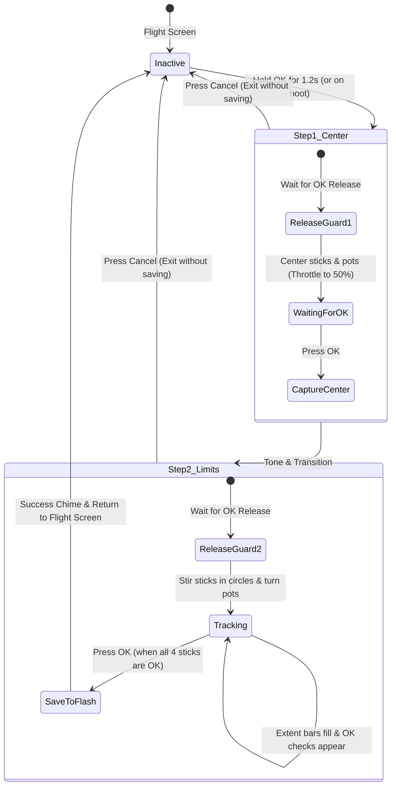

# STICK CALIBRATION & FLASH PERSISTENCE

Technical documentation for the interactive 2-step calibration wizard and the non-volatile Flash configuration storage on the FlySky FS-i6X.

---

## 1. Flash Storage Layout (`src/storage.rs`)

Configuration and model memories are stored in an 8 KB append-only log across the final four 2 KB sectors of the microcontroller's 128 KB internal Flash:
- **Flash Storage Range:** `0x0801_E000 .. 0x0802_0000` (Pages 60, 61, 62, & 63 of STM32F072VB).
- **Total Sector Size:** 8,192 bytes (4 × 2048-byte pages).
- **Storage Engine:** Log-structured append-only Key-Value map powered by the `sequential-storage` crate (`sequential_storage::map`).
- **Key-Value Mapping:**
  - **Key `0`:** Global radio configuration (`RadioConfig`, 140 bytes).
  - **Keys `1..=20`:** Model memory slots 1 through 20 (`ModelConfig`, 128 bytes each).
- **Append-Only Write Performance:**
  - Incremental updates write only ~132 bytes to the active flash log page in **~2.8 ms** (measured on hardware).
  - **Zero page erases** during routine operation: editing trims, curves, or model settings causes zero perceptible UI stutter or audio glitch.
  - **Automatic Wear-Levelled Compaction:** When all 4 pages become full of historical revisions, `sequential-storage` automatically compacts current active records into a newly erased page, rotating evenly across Pages 60–63.
  - **Watchdog Protection:** During multi-page compaction routines, the hardware watchdog (`pac::IWDG`) is explicitly fed between page erase cycles, preventing 2.0s resets.

### Storage Structures (`RadioStorage` v5)

All storage structures are compiled with strict C-compatible alignment (`#[repr(C)]`) and compile-time size assertions (`core::mem::size_of`):

```rust
pub const FLASH_MAGIC: u32 = 0x4653_4B59; // "FSKY"
pub const CONFIG_VERSION: u32 = 5;
pub const NUM_MODELS: usize = 20;

#[repr(C)]
pub struct ChannelCalib {
    pub min: u16,      // Minimum endpoint (raw ADC counts)
    pub center: u16,   // Neutral resting center (raw ADC counts)
    pub max: u16,      // Maximum endpoint (raw ADC counts)
    pub _pad: u16,     // 32-bit alignment padding
}

#[repr(C)]
pub struct PotCalib {
    pub min: u16,      // Minimum endpoint (raw ADC counts)
    pub center: u16,   // Neutral resting center (raw ADC counts)
    pub max: u16,      // Maximum endpoint (raw ADC counts)
}

/// Global radio settings (exactly 140 bytes, 4-byte aligned)
#[repr(C)]
pub struct RadioConfig {
    pub magic: u32,                // 0..4 ("FSKY")
    pub version: u32,              // 4..8 (5)
    pub active_model: u8,          // 8 (0..19, active model index)
    pub throttle_trim: u8,         // 9 (0: Off/Lock, 1: Idle T-Trim, 2: Linear)
    pub audio_enabled: u8,         // 10 (0: Muted, 1: Enabled)
    pub backlight_timeout: u8,     // 11 (0: Always On, 1: 15s, 2: 30s, 3: 60s)
    pub backlight_brightness: u8,  // 12 (1..10)
    pub vbat_warn_deci: u8,        // 13 (40..50 = 4.0V..5.0V, default 44 = 4.4V)
    pub lcd_contrast: u8,          // 14 (15..55, default 37 / 0x25)
    pub usb_mode: u8,              // 15 (0: Off, 1: Joystick, 2: Serial, 3: Composite)
    pub sticks: [ChannelCalib; 4], // 16..48 (32 bytes: Roll, Pitch, Throttle, Yaw)
    pub aux_pots: [PotCalib; 10],  // 48..108 (60 bytes: SA..SD, VRA..VRB, VRC..VRF)
    pub ext_module_pwr: u8,        // 108 (0: Active HIGH / N-type, 1: Active LOW / P-type)
    pub tone_style: u8,            // 109 (0: Simple / Standard, 1: Rich / Melodic)
    pub servo_rate_hz: u16,        // 110..112 (50..400 Hz, default 50 Hz for analog servo safety)
    pub rx_out_mode: u8,           // 112 (0: PWM, 1: PPM, default 0)
    pub rx_serial_proto: u8,       // 113 (0: i-BUS, 1: S.BUS, default 0)
    pub ext_switches: u8,          // 114 (0: Disabled, 1: Enabled / PC12+PC15)
    pub ext_adc: u8,               // 115 (0: Disabled, 1: Enabled / Header P7 AD12-AD15)
    pub adc_modes: [u8; 10],       // 116..126: Input modes for the 10 auxiliary analog channels
    pub stick_mode: u8,            // 126: (0: Mode 1, 1: Mode 2, 2: Mode 3, 3: Mode 4)
    pub telem_slots: [u8; 4],      // 127..131: Configurable telemetry dashboard sensor slots (1..4)
    pub trainer_mode: u8,          // 131: 0 = Off, 1 = PPM Out (PF10), 2 = Trainer In (PF9)
    pub rear_btn_l: u8,            // 132: Rear Left button mode (0: RC Sw, 1: Timer Reset, 2: Instant Trim, 3: Trims Mod)
    pub rear_btn_r: u8,            // 133: Rear Right button mode
    pub swd_mode: u8,              // 134: 0: SWD Debug, 1: SG/SH Buttons
    pub touch_enabled: u8,         // 135: 0: Disabled, 1: Enabled (FS-i6S touchscreen)
    pub switch_sound: u8,          // 136: 0: Off, 1: On (switch toggle acoustic chime)
    pub _reserved: [u8; 3],        // 137..140 (3 bytes reserved, 4-byte aligned 140-byte layout)
}

/// A single freeform mix rule in the matrix mixer (8 bytes)
#[repr(C)]
#[derive(Copy, Clone, Debug, PartialEq, Eq)]
pub struct MixLine {
    pub target_ch: u8,   // 0: Disabled, 1..18: Target Channel CH1..CH18
    pub source: u8,      // 0: None, 1: Roll, 2: Pitch, 3: Thr, 4: Yaw, 5: VRA, 6: VRB, 7..10: SA..SD, 11: MAX, 12..29: CH1..CH18, 30: Thr+, 31..40: SE..VRF
    pub weight_src: u8,  // 0: Fixed Weight, 1..18: Modulate with CH1..CH18 (Bipolar), 19..36: Modulate (Unipolar 0..100%)
    pub weight: i8,      // -100% .. +100%
    pub offset: i8,      // -100% .. +100%
    pub switch: u8,      // 0: Always On, 1..22: Switch condition (SA^..SWJv)
    pub mode: u8,        // 0: Add (+), 1: Multiply (*), 2: Replace (:=)
    pub _reserved: u8,   // 1-byte padding for 8-byte alignment
}

/// Per-model profile configuration (exactly 348 bytes)
#[repr(C)]
#[derive(Copy, Clone, Debug, PartialEq, Eq)]
pub struct ModelConfig {
    pub name: [u8; 10],            // 10-char ASCII model name (e.g. "QUAD 5IN  ")
    pub model_type: u8,            // 0: Airplane, 1: Glider, 2: Helicopter, 3: Multirotor / Quad, 4: General (Boats/Rovers)
    pub _pad0: u8,                 // Align rx_id
    pub rx_id: u32,                // Bound receiver ID (Model Match)
    pub trims: [i8; 4],            // -25 .. +25 (Roll, Pitch, Throttle, Yaw)
    pub channel_reverse: u32,      // 18-bit channel reversing mask (bit 0=CH1 .. bit 17=CH18)
    pub dr_switch: u8,             // 0: None, 1: SA, 2: SB, 3: SC, 4: SD, 5: SE, 6: SF
    pub thr_curve_pts: u8,         // 5, 7, or 9 points
    pub thr_curve_smooth: u8,      // 0: Linear interpolation, 1: Catmull-Rom spline
    pub thr_curve: [u8; 17],       // Throttle curve points (0..100%, reserved up to 17)
    pub _pad_crv: u8,              // Alignment padding
    pub dr_high: [u8; 3],          // High rates: AIL, ELE, RUD (50..100%)
    pub dr_low: [u8; 3],           // Low rates: AIL, ELE, RUD (30..100%)
    pub expo_high: [i8; 3],        // High expo (-100..+100%)
    pub expo_low: [i8; 3],         // Low expo (-100..+100%)
    pub _pad1: u8,                 // Alignment padding
    pub timer_secs: u16,           // Countdown timer in seconds (e.g. 300 = 5 min)
    pub timer_source: u8,          // 0: Off, 1: THs (Thr>5%), 2: THt (Thr Latched), 3: Always On, 4..17: SA^..SFv
    pub rf_power: u8,              // AFHDS 2A RF power (0: 100mW, 1: 10mW, 2: 1mW, 3: 100uW)
    pub failsafe_thr: u16,         // Failsafe throttle pulse in µs (e.g. 1000)
    pub aux_channels: [u8; 14],    // Source for CH5..CH18
    pub wing_tail_mix: u8,         // 0: Normal, 1: Elevon/Delta, 2: V-Tail, 3: Flaperon
    pub template_diff: i8,         // Differential / mix ratio (-100..+100)
    pub mixes: [MixLine; 32],      // 32 freeform mix rules (32 * 8 = 256 bytes)
    pub failsafe_mode: u8,         // 0: Hold last, 1: Custom pulses
    pub failsafe_timeout: u8,      // 10..50 (1.0s..5.0s)
    pub rf_protocol: u8,           // 0: AFHDS 2A, 1: CRSF / ELRS
    pub crsf_baud: u8,             // 0: 115.2k, 1: 416.6k, 2: 420k, 3: 921.6k, 4: 1.875M
    pub arm_switch: u8,            // 0: None, 1..14: SA^..SFv
    pub rx_out_mode: u8,           // 0: PWM, 1: PPM (default 0)
    pub servo_rate_hz: u16,        // 50..400 Hz (default 50 Hz for analog servo safety)
    pub rx_serial_proto: u8,       // 0: i-BUS, 1: S.BUS (default 0)
    pub crsf_half_duplex: u8,      // 0: Full-Duplex (2-Wire), 1: Half-Duplex (1-Wire)
    pub _pad_end: [u8; 2],         // Align struct to 4-byte boundary
}

/// Active-Model Cache Storage layout (exactly 488 bytes in memory)
#[repr(C)]
pub struct RadioStorage {
    pub radio: RadioConfig,                // 140 bytes
    pub active_model: ModelConfig,         // 348 bytes (cached active model in SRAM)
}
```

### Pure PAC Flash Hardware Driver (`FlashStorage`)
The underlying flash driver implements `embedded_storage::nor_flash::NorFlash` and `MultiwriteNorFlash` directly using the STM32 PAC (`stm32f0::stm32f0x2::pac::FLASH`):
- **Unlock Sequence:** Unlocks flash control registers via `FLASH_KEYR` (`0x4567_0123`, `0xCDEF_89AB`).
- **Register Hygiene (`write_with_zero`):** Uses `write_with_zero` on `FLASH_CR` to prevent inadvertent re-assertion of the `LOCK` bit when setting `PER` (Page Erase) or `PG` (Programming).
- **Error Flag Clearing:** Clears pending `EOP`, `WRPRTERR`, and `PGERR` flags in `FLASH_SR` before initiating erase or write commands.
- **16-Bit Halfword Programming:** Programs data in halfword increments with hardware `BSY` polling and post-write verification.
- **In-Flight Flash Write Protection:** To prevent SPI bus contention, flash programming latency spikes, and CPU stalls while flying, all flash persistence routines (`save_active_model`, `save_storage`) are strictly inhibited while the aircraft is armed (`!pipeline.prev_armed`).
- **Debounced Active Model Trim Auto-Save:** Modifications to trim rockers (`roll`, `pitch`, `throttle`, `yaw`) are automatically tracked in `BackgroundIdleManager::tick`. Trim changes trigger a 2000 ms debounce timer. Once adjustments settle and the aircraft is disarmed, the updated trims are safely appended to the active model record in Flash without user intervention.
- **Safe Receiver ID Persistence Outside ISR:** When an over-the-air bind succeeds in the RF interrupt, the captured `rx_id` is passed via a thread-safe atomic flag to the background execution loop, deferring Flash persistence until the radio is outside interrupt context and verified disarmed.

### Automatic Migration & Backward Compatibility
The configuration loader follows an automatic multi-tier fallback:
1. **Sequential Storage Check**: Probes the 4-page log across Pages 60–63 (`0x0801_E000`). If valid keys exist, loads radio config (Key 0) and model profiles (Keys 1..20).
2. **Legacy v3 Snapshot Migration**: If sequential storage is empty, probes the old snapshot base at Page 62 (`0x0801_F000`) for `magic == 0x4653_4B59`. If found, migrates `RadioConfig` and all 20 `ModelConfig` records into the sequential log.
3. **Legacy v1/v2 Migration**: If Page 62 is unprogrammed, probes Page 63 (`0x0801_F800`) for legacy signatures:
   - Copies existing stick and pot calibration into `storage.radio`.
   - Copies existing `rx_id` into Model 01.
   - Copies radio preferences (audio, backlight, contrast, etc.).
   - Migrates the structure into sequential storage.
4. **Factory Default Fallback**: If no valid signature is found anywhere, initializes clean default calibrations, creates default model names (`MODEL 01` through `MODEL 20`), sets standard 5-point linear throttle curves (`[0, 25, 50, 75, 100]`), and commits Key 0 through Key 20 to the append-only log.

---

## 2. Endpoint Calibration Wizard (`src/calib.rs`)

The calibration wizard provides an interactive on-screen workflow to measure the true physical limits of the transmitter gimbals and rotary dials:



---

## 3. Calibration Steps Explained

### Step 1 (Center)
1. **Key Release Guard**: When entering the wizard from the flight dashboard by holding `OK` for 1.2s, the wizard requires `OK` to be physically released before accepting input. This prevents accidentally skipping Step 1.
2. **Neutral Reference**: The user leaves Roll, Pitch, and Yaw spring-centered, manually positions the friction Throttle stick to the physical middle (50%), and centers all active potentiometers.
3. **Capture**: Pressing `[OK]` records `centers` and initializes `mins` and `maxs` across sticks and all currently configured continuous potentiometers (`collect_configured_pots`).

### Step 2 (Limits & Margins)
1. **Dynamic Tracking**: The user moves both sticks in full circles touching all 4 corners, and rotates all active rotary dials from stop to stop.
2. **Real-Time Display**:
   - **Gimbals**: 4 primary stick gauges (`A`, `E`, `T`, `R`) with symmetric inner spans. Extent fill lines and live cursor ticks track full throw. Once an axis has measured sufficient deflection (>= 250 counts in both directions), its status changes from `--` to `OK`.
   - **Dynamic Potentiometer Layout**: The wizard dynamically collects all channels configured as continuous potentiometers (`AdcInputMode::Pot` or `AdcInputMode::PotDetent`).
     - **<= 2 Pots active**: Renders full-width single or dual gauges with center reference ticks and sliding cursors.
     - **3..4 Pots active**: Switches to a 2-column split layout with compact bars.
     - **> 4 Pots active**: Renders a dense multi-channel matrix tracking calibration across all extended dials.
3. **Potentiometer Physics & ADC Range**:
   - The STM32 12-bit ADC spans `0..4095` counts (0V..3.3V).
   - However, standard rotary potentiometers have an electrical rotation angle of ~270°, whereas transmitter gimbals physically only tilt ±25° (a total travel of ~50°).
   - Consequently, the physical wiper only traverses ~20%..25% of the resistive element, producing raw ADC counts between ~380 and ~3720. The hardware physically cannot output 0 or 4095.
   - The calibration gauges scale dynamically to this physical travel (rather than fixed full-rail 0..4095), allowing the fill and cursors to cleanly reach the outer edges of the screen boxes at physical stops.
4. **Tolerance Margin Application**:
   When `[OK]` is pressed, the wizard applies OpenTX standard margin (`STICK_TOLERANCE = 64`):
   ```text
   effective_min = center - ((center - min) * 63) / 64
   effective_max = center + ((max - center) * 63) / 64
   ```
   This ~1.6% margin ensures ±100% (and 0% / 100% for throttle) is reliably reached right at the gimbal bezel without straining the gimbal arms.
5. **Commit**: Updates active runtime calibration in `input::apply_calibration`, writes `RadioConfig` to Flash, plays the 2-tone success chime, and displays `CALIBRATION SAVED!`.

---

## 4. Operational Shortcuts

- **Hold `OK` for 1.2s** on the flight dashboard: launches calibration.
- **Hold `OK` during Power-On**: launches calibration immediately on boot.
- **Press `Cancel` (`ESC`)**: aborts calibration at any stage without changing saved values.

---

## 5. Zero-Alloc In-Place Storage Architecture

To maintain deterministic execution and prevent stack-on-static collisions, configuration persistence is engineered around zero-alloc in-place routines:

### Stack Safety & Direct Flash Access
- **Targeted Key Reads (`load_radio_config`)**: Routines requiring only system settings read Key 0 (128 bytes) directly from the sequential storage log without loading the 20-model array.
- **Granular Model Profile Loading (`load_model_config`)**: Individual model slots are read directly by key (Keys 1..20) into caller-provided references.
- **In-Place Storage Loading (`load_storage_into`)**: Rather than returning a 2,688-byte `RadioStorage` struct by value on the stack, storage routines populate caller-provided references directly (`storage: &mut RadioStorage`).
- **Direct Receiver ID Extraction**: The AFHDS 2A driver directly loads the active model's `rx_id` from sequential storage without allocating temporary buffers.
- **BSS Relocation**: Volatile runtime caches (such as ExpressLRS parameter cache `CONFIG_ENGINE`) are zero-initialized in `.bss` rather than occupying `.data`.

> [!NOTE]
> For the comprehensive Flash partition table, SRAM allocation breakdown, and stack safety margins, see [ARCHITECTURE.md (Memory Footprint)](ARCHITECTURE.md#4-memory-footprint).
